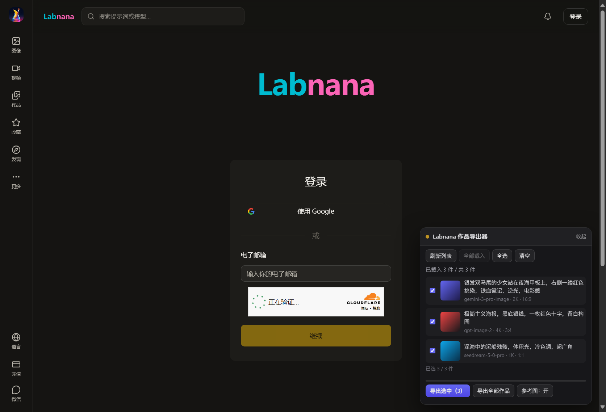

# Labnana 作品导出器

> **非官方工具。** 把你自己在 Labnana 上的作品，连提示词、生成参数、参考图一起存到本地 —— 趁它们还在。



Chrome / Edge / Vivaldi 等 Chromium 内核浏览器，版本 ≥ 116。
无需安装依赖，无需注册，不经过任何第三方服务器。

---

## 为什么做这个

起因很朴素：**喜欢的模型可能说没就没。**

平台可以毫无预告地下架某个模型，此前生成的作品也未必一直留得下来。
社区里问不到答复 —— 那就先把自己的东西拿回本地。

所以这个工具只做一件事：**把你做过的作品，完整地搬到你自己硬盘上。**
图片、提示词、生成参数、参考图，一样不少。

---

## 它能做什么

- **按作品归档**：每件作品一个文件夹，图、参数、参考图放在一起
- **提示词写进图片本身**：拖进 A1111 / ComfyUI 能直接回读
- **参考图存本体，不是链接**：Labnana 的 CDN 是签名临时链接，会过期
- **保留服务端原始记录**：`metadata.json` 里的 `raw` 字段一个不裁，站点改版也不影响旧导出
- **按 ID 补漏**：粘一串作品 ID，只补这些，不用重下已有的
- **按生成日期命名**：文件夹直接叫 `2026-10-24_1351_a3f9`，一眼看出哪天做的
- **中英双语界面**：跟随浏览器语言
- **零依赖**：ZIP 打包器、PNG 元数据写入都是手写的，没有第三方库

---

## 安装

1. 点本页右上角 **Code → Download ZIP**，解压到一个**你不会随手删掉的目录**。
   解压后目录里应该能直接看到 `manifest.json`。
2. 打开扩展管理页：
   - Chrome：地址栏输入 `chrome://extensions`
   - Edge：`edge://extensions`
   - Vivaldi：`vivaldi://extensions`
3. 打开 **开发者模式**（Chrome 在右上角，Edge/Vivaldi 在左下角）。
4. 点 **加载已解压的扩展程序**，选第 1 步解压出来的目录。
5. 打开 <https://labnana.com/zh/library>，确认已登录。

页面右下角会出现面板。看不到就刷新一次页面。

> ⚠️ 装好后**别删那个目录** —— 浏览器是直接从这个目录读取扩展的。
> 想换位置，就在扩展管理页移除后重新加载一次。

---

## 使用

面板上就几个按钮，常用的是前两步：

| 按钮 | 作用 |
| --- | --- |
| **刷新列表** | 拉第 1 页（40 件） |
| **全部载入** | 自动翻页，把作品都拉下来 |
| **导出选中** | 导出勾选的作品 |
| **导出全部作品** | 全部载入 + 全选 + 导出，一条龙 |
| **按 ID 导出** | 只导你点名的作品，可整段粘 CSV |
| **参考图：开/关** | 是否打包参考图 |
| **成图：导出/跳过** | 跳过成图，只补参考图和参数 |
| **命名：日期/序号** | 文件夹命名方式 |

默认所有作品都是勾选的，取消勾选即可排除。

一次导出 50 件以上会先弹确认框，告诉你会跑多久、包有多大。
导出过程中状态栏会显示**已用时间和预计剩余**。

---

## 导出包里有什么

```
Labnana-export-20261024-153012.zip
├── 2026-10-24_1351_a3f9/       ← 生成时间 + 作品 ID 末四位
│   ├── image.png              最终成图
│   ├── metadata.json          完整元数据（含服务端原始记录）
│   ├── parameters.txt         提示词 + 参数，人类可读
│   ├── ref_01.png             参考图，按生成时的顺序编号
│   └── ref_02.png
├── 2026-10-24_1502_c71b/
│   └── ...
├── index.csv                  总表，Excel 双击打开不乱码
├── index.json                 总表，机器可读
├── errorlog.txt               有失败时才会出现，完整错误清单
└── README.txt                 给未来的你看的说明
```

几个细节：

- **提示词也写进了 PNG 本体**（iTXt 块），`parameters.txt` 只是方便你不开图就能看。
- **`metadata.json` 的 `raw` 字段是服务端原始返回**，没做任何裁剪。
- **参考图存的是图片本体**，因为签名链接会过期，只记 URL 等于什么都没留下。
- **分卷的情况**：超过约 1.6 GB 会自动切成 `-part1.zip`、`-part2.zip`。
  把**所有分卷解压到同一个文件夹**就等于合并完成 —— 各卷装的是互不重叠的作品，
  索引只出现在最后一卷。多次导出也是同样处理。

---

## 大批量导出有什么限制

**作品数量没有硬上限**，但有四个现实约束：

| 约束 | 数值 | 说明 |
| --- | --- | --- |
| 单次载入 | 20,000 件 | 撞到上限会提示，再点一次「全部载入」继续 |
| 单卷大小 | 约 1.6 GB | 超过自动切卷，规避 ZIP 的 4 GB 上限 |
| 速度 | 约 4 秒/件 | 实测 871 件耗时 59 分钟；3,000 件约 3.5 小时 |
| 内存峰值 | 约 2–4 GB | 每卷做好就立刻交付下载，不在内存里堆所有卷 |

必须知道的几点：

- **导出期间不要关闭浏览器**，任务会中断。已经下载的分卷不受影响。
- **磁盘按 2 倍体积准备**：压缩包本体 + 解压后的目录。
- **两千件以上的账号建议分批导**（比如按年份），中途出岔子损失更小。

---

## 它是什么，不是什么

- **它是**：你自己作品的本地备份工具。
- **它不是**：作品采集器、批量爬虫，或替别人搬运作品的工具。

代码里有三条硬限制，不是摆设：

1. **只导自己的。**
   导出前先确认当前账号 ID，逐条比对作品归属。即便手动粘贴别人的作品 ID，
   也会被跳过，并记进日志和 `errorlog.txt`。
2. **不并发，有间隔。**
   每件之间固定停 120 ms，一件一件来。900 件大约多花两分钟，
   但不会把对方接口打出压力。
3. **没有服务端。**
   所有请求都在你自己的浏览器里发出，没有中转、没有上报、没有第三方域名。

如果你想要的是「把整个站的作品爬下来」，这个工具不合适，也不打算往那个方向做。

---

## 常见问题

**面板没出现？**
刷新一次页面。还不行就确认扩展已启用、当前页面是 `labnana.com`（不是别的域名）。

**提示「登录已失效」？**
在网页上重新登录 Labnana，然后刷新页面。

**参考图全部下载失败，报 `Failed to fetch`？**
是域名白名单问题。参考图存在 `storage.googleapis.com`，如果 Labnana 以后换存储域名，
新域名就不在扩展的 `host_permissions` 里，浏览器会直接拦掉。
报错信息里带了域名，把域名加进 `manifest.json` 的 `host_permissions` 即可。

**提示词是空的？**
说明服务端返回的字段名变了。面板日志会打印真实字段名；
`metadata.json` 的 `raw` 里也完整保留了原始记录，照着改 `lib/labapi.js` 的映射即可。

**作品很多，跑到一半会不会前功尽弃？**
不会。已经交付的分卷已经在下载目录里了。重跑时同名的会被浏览器自动改名。

**能不能导出别人的作品？**
不能，见上一节。这是设计如此。

---

## 可选工具

`tools/` 下有几个 Python 脚本（需要 Python 3，标准库即可，无第三方依赖）。
**日常使用不需要它们** —— 只在补漏、合并、整理时才用得上。

| 脚本 | 用途 |
| --- | --- |
| `merge_exports.py` | 把多个导出包按作品 ID 合并成一个目录 |
| `apply_update.py` | 把新补的作品增量并入已有目录，不重排 |
| `rename_by_date.py` | 把已有目录按生成日期重命名 |
| `fix_dimensions.py` | 补齐早期版本缺失的像素宽高 |

```bash
python tools/merge_exports.py "C:/Users/you/Downloads" -o "D:/Labnana-merged"
python tools/apply_update.py new-export.zip --into "D:/Labnana-merged"
```

每个脚本都支持 `--dry-run` 先看统计不写盘。

---

## 兼容性

| 浏览器 | 状态 |
| --- | --- |
| Chrome / Edge / Vivaldi / Brave（Chromium ≥ 116） | ✅ 支持 |
| Firefox | ❌ 不支持（用了 MV3 的 offscreen 与 MAIN world 注入） |
| Safari | ❌ 不支持 |

---

## English (short)

Unofficial browser extension that exports **your own** Labnana works to local archives,
including prompts, generation parameters and reference images.

- Chromium-based browsers (≥ 116). Load unpacked via `chrome://extensions` → Developer mode.
- Export only ever covers works owned by the signed-in account — other accounts' works are
  skipped by design, requests are serialised with a 120 ms gap, and nothing leaves your machine.
- Prompts are embedded into PNG `iTXt` chunks (readable by A1111 / ComfyUI), and the raw
  server record is preserved in every `metadata.json`.
- Not affiliated with Labnana. The site's private API may change and break this at any time.

---

## 免责

- 这是**非官方**工具，与 Labnana 无关。
- 依赖网页版私有接口（`api.listenhub.ai`），不是公开 API。站点改接口或加风控时可能失效。
- 请仅用于导出**自己**的作品。请勿用于大规模抓取他人内容。
- 若平台方要求，本项目会配合调整或下架。

## 许可证

[MIT](LICENSE)
